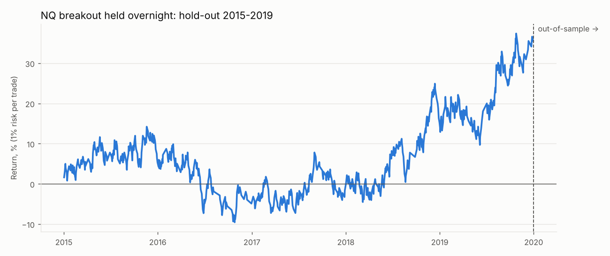

# Hold-out test: NQ breakout held overnight, 2015-2019
One frozen rule, data never used in the research (2020-2026). Nothing was tuned on this period.

## Verdict
- PASS: Positive expectancy after costs
- FAIL: Profit factor >= 1.3
- PASS: At least ~100 trades
- FAIL: Beats random direction (p < 0.05)
- PASS: Not driven by a few huge days (exp. without top 5 > 0)

## Results
| | trades | win_rate | breakeven_win_rate | avg_win_R | avg_loss_R | expectancy_R | profit_factor | return_pct | max_dd_pct | longest_losing_streak | sharpe |
|---|---|---|---|---|---|---|---|---|---|---|---|
| Frozen rule (hold to target/stop) | 727 | 38.65 | 36.81 | 1.74 | -1.02 | 0.05 | 1.08 | 35.54 | -20.80 | 11 | 0.45 |
| long | 391 | 41.18 | 36.67 | 1.76 | -1.02 | 0.13 | 1.21 | 57.14 | -12.67 | 10 | nan |
| short | 336 | 35.71 | 37.00 | 1.73 | -1.01 | -0.04 | 0.95 | -13.74 | -24.88 | 9 | nan |
| Same entries, flat at 16:00 | 1117 | 45.66 | 46.25 | 0.86 | -0.74 | -0.01 | 0.98 | -14.34 | -35.38 | 12 | -0.15 |

Random direction: 16% of 50 coin-flip runs did as well or better (mean +0.008R).

Buy-and-hold NQ 1x over the period: 116.3% (Sharpe 0.87, max DD -22.0%).

Gaps through the stop: 2 trades, average -1.03R, worst -1.03R. Worst trade overall -1.07R.

## By year
| | trades | win_rate | expectancy_R | total_R |
|---|---|---|---|---|
| 2015 | 143.00 | 38.46 | 0.05 | 6.48 |
| 2016 | 137.00 | 35.04 | -0.07 | -9.04 |
| 2017 | 137.00 | 38.69 | 0.03 | 4.57 |
| 2018 | 157.00 | 40.13 | 0.11 | 17.30 |
| 2019 | 153.00 | 40.52 | 0.12 | 17.69 |

