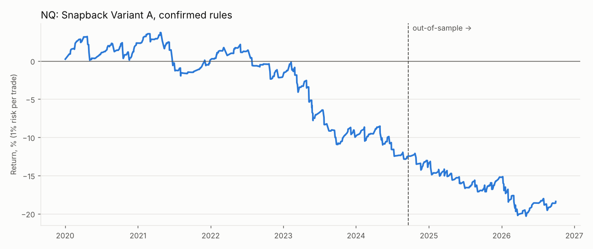
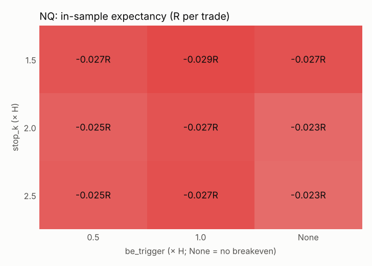
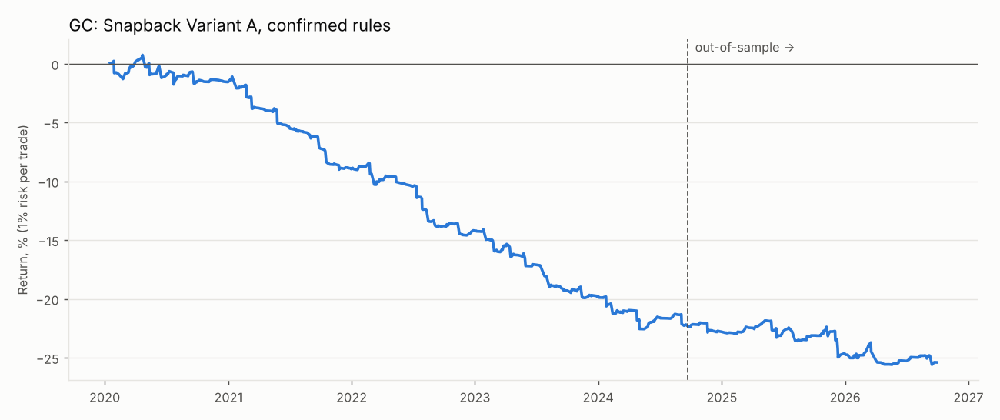
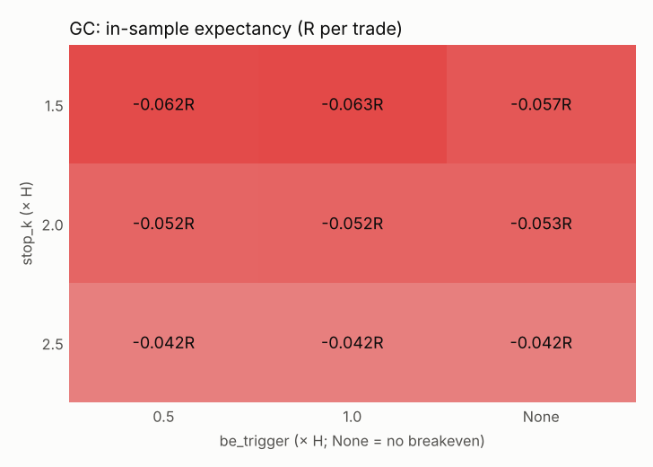

# Snapback Variant A: backtest report
All R figures are after commission and slippage. Win rate is compared with the break-even win rate implied by the average win and loss.

## Verdict
- **NQ: does not pass** the pre-paper-trading criteria. Failed: Positive OOS expectancy after costs; OOS profit factor >= 1.3; No collapse when one parameter moves one step (OOS exp > 0 for each); Beats random direction (p < 0.05); Not driven by a few huge days (exp. without top 5 > 0).
- **GC: does not pass** the pre-paper-trading criteria. Failed: Positive OOS expectancy after costs; OOS profit factor >= 1.3; No collapse when one parameter moves one step (OOS exp > 0 for each); Beats random direction (p < 0.05); Not driven by a few huge days (exp. without top 5 > 0).

## NQ
Sessions: 1744 (2020-01-02 → 2026-10-01); in-sample before 2024-09-20, out-of-sample after. Days skipped for contract roll: 1. Trades whose first target was already at or behind the entry price (long snapback candle): 244.
### Confirmed rules
| | trades | win_rate | breakeven_win_rate | avg_win_R | avg_loss_R | expectancy_R | profit_factor | max_dd_pct | longest_losing_streak | sharpe | no_setup_pct |
|---|---|---|---|---|---|---|---|---|---|---|---|
| In-sample | 485 | 52.99 | 59.98 | 0.15 | -0.23 | -0.03 | 0.75 | -15.98 | 8 | -0.77 | 60.16 |
| Out-of-sample | 203 | 64.04 | 70.14 | 0.17 | -0.39 | -0.03 | 0.76 | -9.35 | 3 | -0.83 | 60.99 |
| long (OOS) | 109 | 69.72 | 75.20 | 0.17 | -0.52 | -0.04 | 0.76 | -5.04 | 3 | nan |  |
| short (OOS) | 94 | 57.45 | 64.10 | 0.16 | -0.28 | -0.03 | 0.76 | -5.45 | 3 | nan |  |

**Win rate vs break-even:** OOS win rate 64.0% against the 70.1% needed to break even at these average win/loss sizes.

### Baselines (out-of-sample)
| | trades | win_rate | expectancy_R | profit_factor | sharpe |
|---|---|---|---|---|---|
| Strategy (confirmed rules) | 203 | 64.04 | -0.03 | 0.76 | -0.83 |
| Immediate breakout entry | 521 | 61.80 | -0.01 | 0.89 | -0.52 |
| Random direction (mean of seeds) | 203 |  | -0.01 |  |  |

Random-direction: 84% of 50 coin-flip runs did as well or better (p = 0.84).

Buy-and-hold 1x: in-sample 142.5% (Sharpe 0.78), out-of-sample 36.1% (Sharpe 0.71, max DD -29.0%).

### In-sample grid pick, checked out-of-sample
Best of 384 exit combinations in-sample: `stop_k=1.5, be_trigger=1.0, trail_mode=swing, trail_buffer=0.1, target_mode=hold`

| | trades | win_rate | breakeven_win_rate | avg_win_R | avg_loss_R | expectancy_R | profit_factor | max_dd_pct | longest_losing_streak | sharpe | no_setup_pct |
|---|---|---|---|---|---|---|---|---|---|---|---|
| In-sample (picked here) | 485 | 43.30 | 38.24 | 1.20 | -0.74 | 0.10 | 1.23 | -20.47 | 11 | 0.59 | 60.16 |
| Out-of-sample | 203 | 45.81 | 50.81 | 0.85 | -0.88 | -0.09 | 0.82 | -30.95 | 7 | -0.69 | 60.99 |

### Walk-forward
| | trades | win_rate | expectancy_R | profit_factor | max_dd_pct |
|---|---|---|---|---|---|
| Walk-forward (stitched test windows) | 488 | 47.13 | 0.02 | 1.05 | -29.11 |

| | test_start | test_end | train_exp_R | test_trades | test_exp_R | params |
|---|---|---|---|---|---|---|
| 0 | 2022-01-02 | 2022-07-02 | 0.08 | 44 | -0.11 | stop_k=1.5, be_trigger=1.0, trail_mode=points, trail_points=1.0, target_mode=rr, rr_target=2.0 |
| 1 | 2022-07-02 | 2023-01-02 | 0.06 | 51 | -0.04 | stop_k=1.5, be_trigger=0.5, trail_mode=points, trail_points=1.0, target_mode=hold |
| 2 | 2023-01-02 | 2023-07-02 | 0.06 | 61 | -0.08 | stop_k=1.5, be_trigger=0.5, trail_mode=swing, trail_buffer=0.0, target_mode=rr, rr_target=2.0 |
| 3 | 2023-07-02 | 2024-01-02 | 0.00 | 51 | 0.11 | stop_k=1.5, be_trigger=1.0, trail_mode=swing, trail_buffer=0.0, target_mode=hold |
| 4 | 2024-01-02 | 2024-07-02 | 0.11 | 53 | 0.29 | stop_k=1.5, be_trigger=0.5, trail_mode=swing, trail_buffer=0.0, target_mode=hold |
| 5 | 2024-07-02 | 2025-01-02 | 0.16 | 47 | 0.61 | stop_k=1.5, be_trigger=1.0, trail_mode=swing, trail_buffer=0.0, target_mode=hold |
| 6 | 2025-01-02 | 2025-07-02 | 0.29 | 41 | -0.03 | stop_k=1.5, be_trigger=1.0, trail_mode=swing, trail_buffer=0.0, target_mode=hold |
| 7 | 2025-07-02 | 2026-01-02 | 0.30 | 58 | -0.23 | stop_k=1.5, be_trigger=1.0, trail_mode=swing, trail_buffer=0.0, target_mode=hold |
| 8 | 2026-01-02 | 2026-07-02 | 0.19 | 53 | -0.24 | stop_k=1.5, be_trigger=1.0, trail_mode=swing, trail_buffer=0.0, target_mode=hold |
| 9 | 2026-07-02 | 2027-01-02 | 0.02 | 29 | -0.01 | stop_k=2.0, be_trigger=1.0, trail_mode=swing, trail_buffer=0.0, target_mode=hold |

### Sensitivity (one change at a time)
| | IS exp R | IS PF | IS trades | OOS exp R | OOS PF | OOS trades | OOS win % |
|---|---|---|---|---|---|---|---|
| confirmed rules | -0.03 | 0.75 | 485.00 | -0.03 | 0.76 | 203.00 | 64.04 |
| stop_k=1.5 | -0.03 | 0.78 | 485.00 | -0.05 | 0.70 | 203.00 | 60.59 |
| stop_k=2.5 | -0.03 | 0.72 | 485.00 | -0.04 | 0.70 | 203.00 | 65.02 |
| be_trigger=0.5 | -0.02 | 0.77 | 485.00 | -0.03 | 0.76 | 203.00 | 64.53 |
| be_trigger=None | -0.02 | 0.77 | 485.00 | -0.03 | 0.77 | 203.00 | 61.58 |
| be_buffer=0.0 | -0.03 | 0.75 | 485.00 | -0.03 | 0.76 | 203.00 | 64.04 |
| be_buffer=0.1 | -0.03 | 0.75 | 485.00 | -0.03 | 0.76 | 203.00 | 64.04 |
| touch_depth=0.25 | -0.00 | 0.92 | 218.00 | -0.02 | 0.80 | 69.00 | 57.97 |
| touch_depth=-0.1 | -0.04 | 0.70 | 611.00 | -0.02 | 0.87 | 261.00 | 65.52 |
| require_turn_candle=False | -0.04 | 0.73 | 653.00 | -0.02 | 0.87 | 280.00 | 66.43 |
| max_wait_bars=3 | -0.03 | 0.71 | 447.00 | -0.04 | 0.75 | 186.00 | 65.59 |
| max_wait_bars=12 | -0.03 | 0.75 | 531.00 | -0.03 | 0.77 | 218.00 | 63.30 |
| allow_reentry_after_close_inside=True | -0.02 | 0.83 | 701.00 | -0.03 | 0.78 | 298.00 | 61.41 |
| skip_pct=10 | -0.06 | 0.58 | 351.00 | -0.03 | 0.81 | 159.00 | 67.30 |
| skip_pct=20 | -0.04 | 0.68 | 261.00 | -0.04 | 0.71 | 111.00 | 66.67 |
| box_open_time=09:00, box_tz=Asia/Tokyo | 0.00 | 1.03 | 483.00 | -0.07 | 0.60 | 214.00 | 58.88 |
| entry_mode=breakout | -0.02 | 0.80 | 1218.00 | -0.01 | 0.89 | 521.00 | 61.80 |
| trail_mode=swing, trail_buffer=0.1 | -0.03 | 0.75 | 485.00 | -0.03 | 0.76 | 203.00 | 64.04 |
| trail_mode=step, trail_step=0.5 | -0.03 | 0.75 | 485.00 | -0.03 | 0.76 | 203.00 | 64.04 |
| trail_mode=step, trail_step=1.0 | -0.03 | 0.75 | 485.00 | -0.03 | 0.76 | 203.00 | 64.04 |
| trail_mode=candle | -0.03 | 0.75 | 485.00 | -0.03 | 0.76 | 203.00 | 64.04 |
| trail_mode=points, trail_points=1.0 | -0.03 | 0.75 | 485.00 | -0.03 | 0.76 | 203.00 | 64.04 |
| trail_mode=points, trail_points=2.0 | -0.03 | 0.75 | 485.00 | -0.03 | 0.76 | 203.00 | 64.04 |
| trail_mode=off | -0.03 | 0.75 | 485.00 | -0.03 | 0.76 | 203.00 | 64.04 |
| target_mode=fixed, target_base=entry | -0.06 | 0.80 | 485.00 | -0.07 | 0.79 | 203.00 | 64.53 |
| target_mode=fixed, target_base=entry, partials=True | -0.05 | 0.83 | 485.00 | -0.06 | 0.81 | 203.00 | 57.14 |
| target_mode=fixed, target_base=box | -0.04 | 0.74 | 485.00 | -0.02 | 0.87 | 203.00 | 67.98 |
| target_mode=fixed, fixed_tp=2 | -0.05 | 0.83 | 485.00 | -0.04 | 0.87 | 203.00 | 60.10 |
| target_mode=fixed, partials=True | -0.04 | 0.80 | 485.00 | -0.04 | 0.82 | 203.00 | 60.59 |
| target_mode=hold | 0.06 | 1.16 | 485.00 | -0.03 | 0.92 | 203.00 | 51.23 |
| target_mode=rr, rr_target=1.0 | -0.02 | 0.94 | 485.00 | -0.10 | 0.76 | 203.00 | 52.71 |
| target_mode=rr, rr_target=2.0 | 0.02 | 1.05 | 485.00 | -0.05 | 0.87 | 203.00 | 51.23 |
| target_mode=rr, rr_target=3.0 | 0.03 | 1.07 | 485.00 | 0.00 | 1.01 | 203.00 | 51.23 |

### By year (confirmed rules, full period)
| | trades | win_rate | expectancy_R | total_R |
|---|---|---|---|---|
| 2020 | 93.00 | 69.89 | 0.03 | 2.37 |
| 2021 | 107.00 | 47.66 | -0.02 | -2.13 |
| 2022 | 95.00 | 46.32 | -0.02 | -2.08 |
| 2023 | 112.00 | 50.00 | -0.08 | -8.42 |
| 2024 | 100.00 | 57.00 | -0.04 | -3.79 |
| 2025 | 99.00 | 58.59 | -0.02 | -2.06 |
| 2026 | 82.00 | 68.29 | -0.05 | -3.75 |

### By weekday (confirmed rules, full period)
| | trades | win_rate | expectancy_R | total_R |
|---|---|---|---|---|
| Mon | 121.00 | 61.16 | -0.01 | -1.29 |
| Tue | 138.00 | 52.17 | -0.03 | -4.13 |
| Wed | 163.00 | 55.21 | -0.05 | -7.53 |
| Thu | 135.00 | 57.04 | -0.01 | -1.38 |
| Fri | 131.00 | 56.49 | -0.04 | -5.54 |

### Pass criteria
- FAIL: Positive OOS expectancy after costs
- FAIL: OOS profit factor >= 1.3
- PASS: At least ~100 OOS trades
- FAIL: No collapse when one parameter moves one step (OOS exp > 0 for each)
- FAIL: Beats random direction (p < 0.05)
- FAIL: Not driven by a few huge days (exp. without top 5 > 0)

## GC
Sessions: 1740 (2020-01-02 → 2026-10-01); in-sample before 2024-09-23, out-of-sample after. Days skipped for contract roll: 24. Trades whose first target was already at or behind the entry price (long snapback candle): 381.
### Confirmed rules
| | trades | win_rate | breakeven_win_rate | avg_win_R | avg_loss_R | expectancy_R | profit_factor | max_dd_pct | longest_losing_streak | sharpe | no_setup_pct |
|---|---|---|---|---|---|---|---|---|---|---|---|
| In-sample | 477 | 31.66 | 51.67 | 0.13 | -0.14 | -0.05 | 0.43 | -23.14 | 21 | -1.90 | 60.25 |
| Out-of-sample | 194 | 40.72 | 48.34 | 0.14 | -0.13 | -0.02 | 0.73 | -4.79 | 8 | -0.74 | 62.11 |
| long (OOS) | 105 | 36.19 | 46.63 | 0.16 | -0.14 | -0.03 | 0.65 | -3.86 | 10 | nan |  |
| short (OOS) | 89 | 46.07 | 49.18 | 0.12 | -0.11 | -0.01 | 0.88 | -2.06 | 8 | nan |  |

**Win rate vs break-even:** OOS win rate 40.7% against the 48.3% needed to break even at these average win/loss sizes.

### Baselines (out-of-sample)
| | trades | win_rate | expectancy_R | profit_factor | sharpe |
|---|---|---|---|---|---|
| Strategy (confirmed rules) | 194 | 40.72 | -0.02 | 0.73 | -0.74 |
| Immediate breakout entry | 509 | 47.74 | 0.01 | 1.20 | 0.72 |
| Random direction (mean of seeds) | 194 |  | -0.03 |  |  |

Random-direction: 34% of 50 coin-flip runs did as well or better (p = 0.34).

Buy-and-hold 1x: in-sample 43.0% (Sharpe 0.49), out-of-sample 43.4% (Sharpe 0.80, max DD -29.1%).

### In-sample grid pick, checked out-of-sample
Best of 384 exit combinations in-sample: `stop_k=2.5, be_trigger=0.5, trail_mode=swing, trail_buffer=0.0, target_mode=hold`

| | trades | win_rate | breakeven_win_rate | avg_win_R | avg_loss_R | expectancy_R | profit_factor | max_dd_pct | longest_losing_streak | sharpe | no_setup_pct |
|---|---|---|---|---|---|---|---|---|---|---|---|
| In-sample (picked here) | 477 | 29.56 | 30.20 | 1.02 | -0.44 | -0.01 | 0.97 | -36.69 | 22 | -0.08 | 60.25 |
| Out-of-sample | 194 | 46.39 | 46.52 | 0.55 | -0.48 | -0.00 | 0.99 | -8.14 | 11 | -0.01 | 62.11 |

### Walk-forward
| | trades | win_rate | expectancy_R | profit_factor | max_dd_pct |
|---|---|---|---|---|---|
| Walk-forward (stitched test windows) | 468 | 37.82 | -0.01 | 0.97 | -25.50 |

| | test_start | test_end | train_exp_R | test_trades | test_exp_R | params |
|---|---|---|---|---|---|---|
| 0 | 2022-01-02 | 2022-07-02 | 0.05 | 45 | -0.32 | stop_k=2.5, be_trigger=0.5, trail_mode=swing, trail_buffer=0.1, target_mode=hold |
| 1 | 2022-07-02 | 2023-01-02 | -0.05 | 51 | -0.06 | stop_k=2.5, be_trigger=0.5, trail_mode=swing, trail_buffer=0.0, target_mode=fixed, fixed_tp=1 |
| 2 | 2023-01-02 | 2023-07-02 | -0.06 | 53 | -0.04 | stop_k=2.5, be_trigger=0.5, trail_mode=swing, trail_buffer=0.0, target_mode=fixed, fixed_tp=1 |
| 3 | 2023-07-02 | 2024-01-02 | -0.05 | 53 | -0.04 | stop_k=2.5, be_trigger=0.5, trail_mode=swing, trail_buffer=0.0, target_mode=fixed, fixed_tp=1 |
| 4 | 2024-01-02 | 2024-07-02 | -0.05 | 52 | -0.05 | stop_k=2.5, be_trigger=0.5, trail_mode=swing, trail_buffer=0.0, target_mode=fixed, fixed_tp=1 |
| 5 | 2024-07-02 | 2025-01-02 | -0.01 | 47 | 0.18 | stop_k=2.0, be_trigger=1.0, trail_mode=candle, target_mode=hold |
| 6 | 2025-01-02 | 2025-07-02 | 0.11 | 50 | 0.11 | stop_k=2.0, be_trigger=0.5, trail_mode=swing, trail_buffer=0.0, target_mode=hold |
| 7 | 2025-07-02 | 2026-01-02 | 0.16 | 44 | 0.15 | stop_k=2.0, be_trigger=1.0, trail_mode=swing, trail_buffer=0.0, target_mode=hold |
| 8 | 2026-01-02 | 2026-07-02 | 0.18 | 45 | 0.09 | stop_k=2.0, be_trigger=1.0, trail_mode=swing, trail_buffer=0.0, target_mode=hold |
| 9 | 2026-07-02 | 2027-01-02 | 0.17 | 28 | -0.11 | stop_k=2.0, be_trigger=1.0, trail_mode=swing, trail_buffer=0.0, target_mode=hold |

### Sensitivity (one change at a time)
| | IS exp R | IS PF | IS trades | OOS exp R | OOS PF | OOS trades | OOS win % |
|---|---|---|---|---|---|---|---|
| confirmed rules | -0.05 | 0.43 | 477.00 | -0.02 | 0.73 | 194.00 | 40.72 |
| stop_k=1.5 | -0.06 | 0.43 | 477.00 | -0.02 | 0.81 | 194.00 | 40.21 |
| stop_k=2.5 | -0.04 | 0.45 | 477.00 | -0.02 | 0.72 | 194.00 | 41.24 |
| be_trigger=0.5 | -0.05 | 0.43 | 477.00 | -0.02 | 0.73 | 194.00 | 40.72 |
| be_trigger=None | -0.05 | 0.42 | 477.00 | -0.02 | 0.69 | 194.00 | 39.69 |
| be_buffer=0.0 | -0.05 | 0.43 | 477.00 | -0.02 | 0.73 | 194.00 | 40.72 |
| be_buffer=0.1 | -0.05 | 0.43 | 477.00 | -0.02 | 0.73 | 194.00 | 40.72 |
| touch_depth=0.25 | -0.04 | 0.30 | 262.00 | -0.01 | 0.66 | 99.00 | 26.26 |
| touch_depth=-0.1 | -0.05 | 0.48 | 563.00 | -0.00 | 0.96 | 245.00 | 44.49 |
| require_turn_candle=False | -0.07 | 0.52 | 658.00 | -0.01 | 0.89 | 258.00 | 51.55 |
| max_wait_bars=3 | -0.05 | 0.44 | 428.00 | -0.02 | 0.79 | 174.00 | 41.38 |
| max_wait_bars=12 | -0.05 | 0.43 | 523.00 | -0.02 | 0.73 | 208.00 | 39.90 |
| allow_reentry_after_close_inside=True | -0.05 | 0.48 | 676.00 | -0.01 | 0.84 | 267.00 | 43.45 |
| skip_pct=10 | -0.04 | 0.48 | 367.00 | -0.03 | 0.67 | 151.00 | 41.72 |
| skip_pct=20 | -0.03 | 0.53 | 280.00 | -0.03 | 0.66 | 126.00 | 41.27 |
| box_open_time=09:00, box_tz=Asia/Tokyo | -0.05 | 0.56 | 479.00 | 0.05 | 1.90 | 168.00 | 66.07 |
| entry_mode=breakout | -0.04 | 0.51 | 1196.00 | 0.01 | 1.20 | 509.00 | 47.74 |
| trail_mode=swing, trail_buffer=0.1 | -0.05 | 0.43 | 477.00 | -0.02 | 0.73 | 194.00 | 40.72 |
| trail_mode=step, trail_step=0.5 | -0.05 | 0.43 | 477.00 | -0.02 | 0.73 | 194.00 | 40.72 |
| trail_mode=step, trail_step=1.0 | -0.05 | 0.43 | 477.00 | -0.02 | 0.73 | 194.00 | 40.72 |
| trail_mode=candle | -0.05 | 0.43 | 477.00 | -0.02 | 0.73 | 194.00 | 40.72 |
| trail_mode=points, trail_points=1.0 | -0.05 | 0.43 | 477.00 | -0.02 | 0.73 | 194.00 | 40.72 |
| trail_mode=points, trail_points=2.0 | -0.05 | 0.43 | 477.00 | -0.02 | 0.73 | 194.00 | 40.72 |
| trail_mode=off | -0.05 | 0.43 | 477.00 | -0.02 | 0.73 | 194.00 | 40.72 |
| target_mode=fixed, target_base=entry | -0.07 | 0.75 | 477.00 | -0.01 | 0.94 | 194.00 | 69.59 |
| target_mode=fixed, target_base=entry, partials=True | -0.08 | 0.75 | 477.00 | 0.01 | 1.02 | 194.00 | 63.92 |
| target_mode=fixed, target_base=box | -0.04 | 0.63 | 477.00 | -0.03 | 0.76 | 194.00 | 52.06 |
| target_mode=fixed, fixed_tp=2 | -0.06 | 0.73 | 477.00 | -0.01 | 0.97 | 194.00 | 60.31 |
| target_mode=fixed, partials=True | -0.06 | 0.62 | 477.00 | -0.01 | 0.90 | 194.00 | 59.28 |
| target_mode=hold | -0.03 | 0.92 | 477.00 | 0.07 | 1.22 | 194.00 | 45.88 |
| target_mode=rr, rr_target=1.0 | -0.08 | 0.79 | 477.00 | 0.03 | 1.11 | 194.00 | 53.09 |
| target_mode=rr, rr_target=2.0 | -0.08 | 0.79 | 477.00 | 0.02 | 1.08 | 194.00 | 45.88 |
| target_mode=rr, rr_target=3.0 | -0.08 | 0.81 | 477.00 | 0.04 | 1.14 | 194.00 | 45.88 |

### By year (confirmed rules, full period)
| | trades | win_rate | expectancy_R | total_R |
|---|---|---|---|---|
| 2020 | 95.00 | 46.32 | -0.02 | -1.52 |
| 2021 | 108.00 | 20.37 | -0.07 | -7.79 |
| 2022 | 96.00 | 29.17 | -0.06 | -5.89 |
| 2023 | 106.00 | 29.25 | -0.06 | -6.72 |
| 2024 | 99.00 | 32.32 | -0.04 | -3.77 |
| 2025 | 94.00 | 41.49 | -0.03 | -2.37 |
| 2026 | 73.00 | 46.58 | -0.01 | -1.00 |

### By weekday (confirmed rules, full period)
| | trades | win_rate | expectancy_R | total_R |
|---|---|---|---|---|
| Mon | 107.00 | 51.40 | -0.01 | -0.62 |
| Tue | 141.00 | 37.59 | -0.01 | -1.14 |
| Wed | 150.00 | 30.67 | -0.09 | -13.64 |
| Thu | 142.00 | 28.87 | -0.07 | -9.58 |
| Fri | 131.00 | 26.72 | -0.03 | -4.07 |

### Pass criteria
- FAIL: Positive OOS expectancy after costs
- FAIL: OOS profit factor >= 1.3
- PASS: At least ~100 OOS trades
- FAIL: No collapse when one parameter moves one step (OOS exp > 0 for each)
- FAIL: Beats random direction (p < 0.05)
- FAIL: Not driven by a few huge days (exp. without top 5 > 0)

