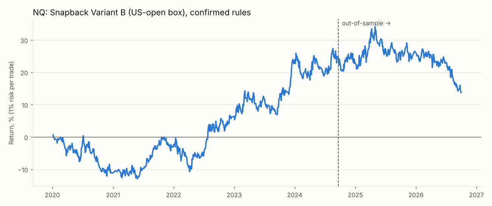
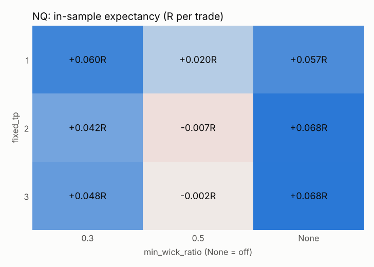
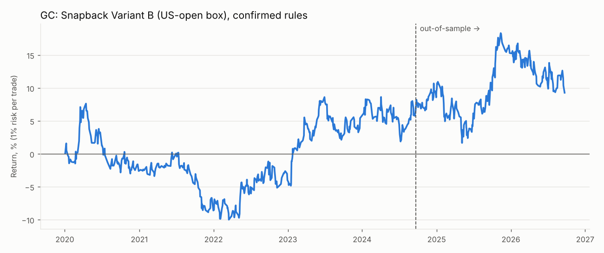
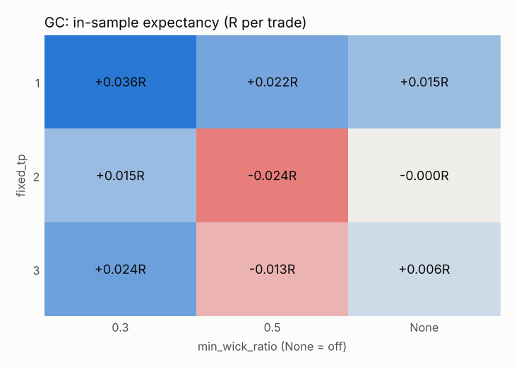

# Snapback Variant B (US-open box): backtest report
All R figures are after commission and slippage. Win rate is compared with the break-even win rate implied by the average win and loss.

## Verdict
- **NQ: does not pass** the pre-paper-trading criteria. Failed: Positive OOS expectancy after costs; OOS profit factor >= 1.3; No collapse when one parameter moves one step (OOS exp > 0 for each); Beats random direction (p < 0.05); Not driven by a few huge days (exp. without top 5 > 0).
- **GC: does not pass** the pre-paper-trading criteria. Failed: OOS profit factor >= 1.3; No collapse when one parameter moves one step (OOS exp > 0 for each); Beats random direction (p < 0.05); Not driven by a few huge days (exp. without top 5 > 0).

## NQ
Sessions: 1745 (2020-01-02 → 2026-09-30); in-sample before 2024-09-20, out-of-sample after. Days skipped for contract roll: 0. Trades whose first target was already at or behind the entry price (long snapback candle): 0.
### Confirmed rules
| | trades | win_rate | breakeven_win_rate | avg_win_R | avg_loss_R | expectancy_R | profit_factor | max_dd_pct | longest_losing_streak | sharpe | no_setup_pct |
|---|---|---|---|---|---|---|---|---|---|---|---|
| In-sample | 579 | 51.30 | 48.52 | 0.79 | -0.74 | 0.04 | 1.12 | -13.52 | 6 | 0.52 | 10.32 |
| Out-of-sample | 263 | 50.19 | 52.51 | 0.66 | -0.73 | -0.03 | 0.91 | -15.18 | 6 | -0.44 | 12.40 |
| long (OOS) | 155 | 54.84 | 55.06 | 0.61 | -0.75 | -0.00 | 0.99 | -7.02 | 4 | nan |  |
| short (OOS) | 108 | 43.52 | 48.65 | 0.74 | -0.70 | -0.07 | 0.81 | -11.61 | 8 | nan |  |
| entry above midline (OOS) | 155 | 54.84 | 55.06 | 0.61 | -0.75 | -0.00 | 0.99 | -7.02 | 4 | nan |  |
| entry below midline (OOS) | 108 | 43.52 | 48.65 | 0.74 | -0.70 | -0.07 | 0.81 | -11.61 | 8 | nan |  |

**Win rate vs break-even:** OOS win rate 50.2% against the 52.5% needed to break even at these average win/loss sizes.

### Baselines (out-of-sample)
| | trades | win_rate | expectancy_R | profit_factor | sharpe |
|---|---|---|---|---|---|
| Strategy (confirmed rules) | 263 | 50.19 | -0.03 | 0.91 | -0.44 |
| Immediate breakout entry | 459 | 50.11 | -0.00 | 1.00 | -0.02 |
| Random direction (mean of seeds) | 263 |  | -0.00 |  |  |

Random-direction: 80% of 50 coin-flip runs did as well or better (p = 0.80).

Buy-and-hold 1x: in-sample 142.5% (Sharpe 0.78), out-of-sample 36.1% (Sharpe 0.71, max DD -29.0%).

### In-sample grid pick, checked out-of-sample
Best of 54 parameter combinations in-sample: `min_wick_ratio=None, b_window_hours=2, fixed_tp=3, be_trigger=1.0`

| | trades | win_rate | breakeven_win_rate | avg_win_R | avg_loss_R | expectancy_R | profit_factor | max_dd_pct | longest_losing_streak | sharpe | no_setup_pct |
|---|---|---|---|---|---|---|---|---|---|---|---|
| In-sample (picked here) | 803 | 53.30 | 48.57 | 0.80 | -0.75 | 0.07 | 1.21 | -9.76 | 8 | 0.99 | 10.32 |
| Out-of-sample | 348 | 49.14 | 52.39 | 0.62 | -0.69 | -0.04 | 0.88 | -20.02 | 7 | -0.68 | 12.40 |

### Walk-forward
| | trades | win_rate | expectancy_R | profit_factor | max_dd_pct |
|---|---|---|---|---|---|
| Walk-forward (stitched test windows) | 701 | 53.50 | 0.05 | 1.14 | -8.96 |

| | test_start | test_end | train_exp_R | test_trades | test_exp_R | params |
|---|---|---|---|---|---|---|
| 0 | 2022-01-02 | 2022-07-02 | 0.05 | 86 | 0.06 | min_wick_ratio=None, b_window_hours=2, fixed_tp=2, be_trigger=1.0 |
| 1 | 2022-07-02 | 2023-01-02 | 0.08 | 85 | 0.16 | min_wick_ratio=None, b_window_hours=2, fixed_tp=3, be_trigger=1.0 |
| 2 | 2023-01-02 | 2023-07-02 | 0.12 | 84 | 0.09 | min_wick_ratio=None, b_window_hours=2, fixed_tp=3, be_trigger=1.0 |
| 3 | 2023-07-02 | 2024-01-02 | 0.12 | 90 | 0.04 | min_wick_ratio=None, b_window_hours=2, fixed_tp=3, be_trigger=1.0 |
| 4 | 2024-01-02 | 2024-07-02 | 0.11 | 59 | -0.02 | min_wick_ratio=0.3, b_window_hours=2, fixed_tp=3, be_trigger=1.0 |
| 5 | 2024-07-02 | 2025-01-02 | 0.12 | 74 | 0.06 | min_wick_ratio=0.3, b_window_hours=2, fixed_tp=3, be_trigger=1.0 |
| 6 | 2025-01-02 | 2025-07-02 | 0.08 | 70 | 0.06 | min_wick_ratio=0.3, b_window_hours=2, fixed_tp=1, be_trigger=None |
| 7 | 2025-07-02 | 2026-01-02 | 0.09 | 54 | 0.03 | min_wick_ratio=0.3, b_window_hours=2, fixed_tp=1, be_trigger=None |
| 8 | 2026-01-02 | 2026-07-02 | 0.06 | 64 | 0.01 | min_wick_ratio=0.3, b_window_hours=2, fixed_tp=1, be_trigger=None |
| 9 | 2026-07-02 | 2027-01-02 | 0.07 | 35 | -0.18 | min_wick_ratio=0.3, b_window_hours=2, fixed_tp=1, be_trigger=None |

### Sensitivity (one change at a time)
| | IS exp R | IS PF | IS trades | OOS exp R | OOS PF | OOS trades | OOS win % |
|---|---|---|---|---|---|---|---|
| confirmed rules | 0.04 | 1.12 | 579.00 | -0.03 | 0.91 | 263.00 | 50.19 |
| box_open_time=09:30 | 0.04 | 1.13 | 532.00 | -0.02 | 0.93 | 195.00 | 49.23 |
| min_wick_ratio=0.5 | -0.01 | 0.98 | 366.00 | -0.11 | 0.71 | 166.00 | 46.99 |
| min_wick_ratio=None | 0.07 | 1.19 | 803.00 | -0.03 | 0.92 | 348.00 | 48.56 |
| touch_depth=0.25 | 0.08 | 1.21 | 44.00 | 0.45 | 3.19 | 17.00 | 70.59 |
| touch_depth=-0.1 | 0.04 | 1.10 | 752.00 | -0.02 | 0.95 | 332.00 | 51.20 |
| b_window_hours=4 | 0.02 | 1.06 | 749.00 | -0.05 | 0.86 | 332.00 | 48.49 |
| b_window_hours=None | 0.02 | 1.05 | 827.00 | -0.05 | 0.86 | 365.00 | 48.49 |
| fixed_tp=1 | 0.06 | 1.18 | 579.00 | 0.00 | 1.01 | 263.00 | 53.61 |
| fixed_tp=3 | 0.05 | 1.13 | 579.00 | -0.05 | 0.86 | 263.00 | 49.81 |
| stop_k=0.5 | 0.03 | 1.05 | 579.00 | -0.10 | 0.81 | 263.00 | 38.40 |
| stop_k=1.5 | 0.01 | 1.04 | 579.00 | -0.04 | 0.87 | 263.00 | 51.71 |
| cancel_on_close_inside=True | 0.07 | 1.20 | 366.00 | -0.04 | 0.90 | 175.00 | 52.00 |
| eod_exit=False | 0.02 | 1.04 | 474.00 | 0.01 | 1.01 | 206.00 | 35.92 |
| be_trigger=1.0 | 0.05 | 1.13 | 579.00 | -0.03 | 0.91 | 263.00 | 51.33 |
| be_trigger=0.5 | 0.05 | 1.16 | 579.00 | -0.03 | 0.91 | 263.00 | 57.41 |
| skip_pct=10 | 0.04 | 1.10 | 410.00 | -0.03 | 0.92 | 188.00 | 50.00 |
| entry_mode=breakout | 0.04 | 1.11 | 1095.00 | -0.00 | 1.00 | 459.00 | 50.11 |

### By year (confirmed rules, full period)
| | trades | win_rate | expectancy_R | total_R |
|---|---|---|---|---|
| 2020 | 130.00 | 45.38 | -0.09 | -11.35 |
| 2021 | 107.00 | 56.07 | 0.09 | 9.65 |
| 2022 | 127.00 | 51.97 | 0.07 | 9.12 |
| 2023 | 122.00 | 56.56 | 0.13 | 15.41 |
| 2024 | 133.00 | 48.12 | 0.00 | 0.23 |
| 2025 | 124.00 | 53.23 | 0.03 | 3.41 |
| 2026 | 99.00 | 45.45 | -0.11 | -10.44 |

### By weekday (confirmed rules, full period)
| | trades | win_rate | expectancy_R | total_R |
|---|---|---|---|---|
| Mon | 158.00 | 49.37 | -0.01 | -1.40 |
| Tue | 163.00 | 50.92 | -0.01 | -1.07 |
| Wed | 178.00 | 48.31 | -0.01 | -1.07 |
| Thu | 178.00 | 51.69 | 0.06 | 10.55 |
| Fri | 165.00 | 54.55 | 0.05 | 9.02 |

### Pass criteria
- FAIL: Positive OOS expectancy after costs
- FAIL: OOS profit factor >= 1.3
- PASS: At least ~100 OOS trades
- FAIL: No collapse when one parameter moves one step (OOS exp > 0 for each)
- FAIL: Beats random direction (p < 0.05)
- FAIL: Not driven by a few huge days (exp. without top 5 > 0)

## GC
Sessions: 1741 (2020-01-02 → 2026-09-30); in-sample before 2024-09-20, out-of-sample after. Days skipped for contract roll: 0. Trades whose first target was already at or behind the entry price (long snapback candle): 0.
### Confirmed rules
| | trades | win_rate | breakeven_win_rate | avg_win_R | avg_loss_R | expectancy_R | profit_factor | max_dd_pct | longest_losing_streak | sharpe | no_setup_pct |
|---|---|---|---|---|---|---|---|---|---|---|---|
| In-sample | 480 | 48.96 | 47.62 | 0.61 | -0.55 | 0.02 | 1.05 | -16.37 | 9 | 0.21 | 19.29 |
| Out-of-sample | 239 | 47.28 | 46.11 | 0.68 | -0.58 | 0.01 | 1.05 | -8.37 | 8 | 0.20 | 16.83 |
| long (OOS) | 132 | 48.48 | 45.37 | 0.68 | -0.56 | 0.04 | 1.13 | -9.70 | 8 | nan |  |
| short (OOS) | 107 | 45.79 | 46.96 | 0.67 | -0.60 | -0.01 | 0.95 | -7.75 | 9 | nan |  |
| entry above midline (OOS) | 132 | 48.48 | 45.37 | 0.68 | -0.56 | 0.04 | 1.13 | -9.70 | 8 | nan |  |
| entry below midline (OOS) | 107 | 45.79 | 46.96 | 0.67 | -0.60 | -0.01 | 0.95 | -7.75 | 9 | nan |  |

**Win rate vs break-even:** OOS win rate 47.3% against the 46.1% needed to break even at these average win/loss sizes.

### Baselines (out-of-sample)
| | trades | win_rate | expectancy_R | profit_factor | sharpe |
|---|---|---|---|---|---|
| Strategy (confirmed rules) | 239 | 47.28 | 0.01 | 1.05 | 0.20 |
| Immediate breakout entry | 435 | 47.13 | 0.04 | 1.14 | 0.76 |
| Random direction (mean of seeds) | 239 |  | -0.02 |  |  |

Random-direction: 20% of 50 coin-flip runs did as well or better (p = 0.20).

Buy-and-hold 1x: in-sample 41.1% (Sharpe 0.48), out-of-sample 44.0% (Sharpe 0.81, max DD -29.1%).

### In-sample grid pick, checked out-of-sample
Best of 54 parameter combinations in-sample: `min_wick_ratio=0.3, b_window_hours=2, fixed_tp=1, be_trigger=None`

| | trades | win_rate | breakeven_win_rate | avg_win_R | avg_loss_R | expectancy_R | profit_factor | max_dd_pct | longest_losing_streak | sharpe | no_setup_pct |
|---|---|---|---|---|---|---|---|---|---|---|---|
| In-sample (picked here) | 480 | 51.46 | 48.25 | 0.58 | -0.54 | 0.04 | 1.14 | -10.88 | 9 | 0.54 | 19.29 |
| Out-of-sample | 239 | 49.37 | 48.76 | 0.62 | -0.59 | 0.01 | 1.02 | -9.32 | 7 | 0.11 | 16.83 |

### Walk-forward
| | trades | win_rate | expectancy_R | profit_factor | max_dd_pct |
|---|---|---|---|---|---|
| Walk-forward (stitched test windows) | 574 | 50.00 | 0.03 | 1.10 | -8.03 |

| | test_start | test_end | train_exp_R | test_trades | test_exp_R | params |
|---|---|---|---|---|---|---|
| 0 | 2022-01-02 | 2022-07-02 | 0.00 | 87 | 0.08 | min_wick_ratio=0.3, b_window_hours=None, fixed_tp=1, be_trigger=None |
| 1 | 2022-07-02 | 2023-01-02 | 0.03 | 75 | -0.00 | min_wick_ratio=0.3, b_window_hours=None, fixed_tp=1, be_trigger=None |
| 2 | 2023-01-02 | 2023-07-02 | 0.03 | 76 | 0.13 | min_wick_ratio=0.3, b_window_hours=None, fixed_tp=1, be_trigger=None |
| 3 | 2023-07-02 | 2024-01-02 | 0.07 | 51 | -0.05 | min_wick_ratio=0.3, b_window_hours=2, fixed_tp=3, be_trigger=None |
| 4 | 2024-01-02 | 2024-07-02 | 0.10 | 55 | -0.02 | min_wick_ratio=0.3, b_window_hours=2, fixed_tp=3, be_trigger=None |
| 5 | 2024-07-02 | 2025-01-02 | 0.07 | 40 | 0.02 | min_wick_ratio=0.5, b_window_hours=2, fixed_tp=3, be_trigger=1.0 |
| 6 | 2025-01-02 | 2025-07-02 | 0.08 | 41 | 0.07 | min_wick_ratio=0.5, b_window_hours=2, fixed_tp=3, be_trigger=1.0 |
| 7 | 2025-07-02 | 2026-01-02 | 0.04 | 47 | -0.04 | min_wick_ratio=0.5, b_window_hours=4, fixed_tp=1, be_trigger=None |
| 8 | 2026-01-02 | 2026-07-02 | 0.06 | 88 | -0.00 | min_wick_ratio=None, b_window_hours=2, fixed_tp=1, be_trigger=None |
| 9 | 2026-07-02 | 2027-01-02 | 0.05 | 14 | 0.00 | min_wick_ratio=0.5, b_window_hours=2, fixed_tp=3, be_trigger=None |

### Sensitivity (one change at a time)
| | IS exp R | IS PF | IS trades | OOS exp R | OOS PF | OOS trades | OOS win % |
|---|---|---|---|---|---|---|---|
| confirmed rules | 0.02 | 1.05 | 480.00 | 0.01 | 1.05 | 239.00 | 47.28 |
| box_open_time=09:30 | -0.02 | 0.92 | 440.00 | -0.04 | 0.85 | 205.00 | 47.32 |
| min_wick_ratio=0.5 | -0.02 | 0.91 | 290.00 | 0.06 | 1.19 | 155.00 | 48.39 |
| min_wick_ratio=None | -0.00 | 1.00 | 683.00 | 0.01 | 1.04 | 324.00 | 46.30 |
| touch_depth=0.25 | 0.05 | 1.14 | 25.00 | -0.10 | 0.79 | 19.00 | 42.11 |
| touch_depth=-0.1 | -0.00 | 0.99 | 631.00 | 0.02 | 1.07 | 293.00 | 46.08 |
| b_window_hours=4 | 0.02 | 1.06 | 647.00 | 0.00 | 1.02 | 304.00 | 46.71 |
| b_window_hours=None | 0.02 | 1.07 | 719.00 | 0.01 | 1.03 | 337.00 | 45.40 |
| fixed_tp=1 | 0.04 | 1.14 | 480.00 | 0.01 | 1.02 | 239.00 | 49.37 |
| fixed_tp=3 | 0.02 | 1.08 | 480.00 | 0.02 | 1.05 | 239.00 | 46.86 |
| stop_k=0.5 | -0.01 | 0.98 | 480.00 | 0.03 | 1.06 | 239.00 | 41.42 |
| stop_k=1.5 | -0.00 | 1.00 | 480.00 | 0.02 | 1.09 | 239.00 | 49.37 |
| cancel_on_close_inside=True | 0.05 | 1.17 | 289.00 | -0.02 | 0.92 | 159.00 | 44.65 |
| eod_exit=False | 0.03 | 1.04 | 383.00 | 0.07 | 1.11 | 219.00 | 37.90 |
| be_trigger=1.0 | 0.02 | 1.06 | 480.00 | 0.01 | 1.05 | 239.00 | 47.28 |
| be_trigger=0.5 | 0.01 | 1.04 | 480.00 | -0.00 | 1.00 | 239.00 | 50.63 |
| skip_pct=10 | 0.04 | 1.14 | 342.00 | -0.03 | 0.91 | 181.00 | 45.30 |
| entry_mode=breakout | -0.01 | 0.96 | 983.00 | 0.04 | 1.14 | 435.00 | 47.13 |

### By year (confirmed rules, full period)
| | trades | win_rate | expectancy_R | total_R |
|---|---|---|---|---|
| 2020 | 104.00 | 46.15 | -0.02 | -2.30 |
| 2021 | 87.00 | 45.98 | -0.07 | -6.19 |
| 2022 | 103.00 | 52.43 | 0.05 | 5.25 |
| 2023 | 104.00 | 51.92 | 0.09 | 9.62 |
| 2024 | 118.00 | 47.46 | 0.03 | 4.03 |
| 2025 | 113.00 | 49.56 | 0.05 | 5.63 |
| 2026 | 90.00 | 44.44 | -0.06 | -5.10 |

### By weekday (confirmed rules, full period)
| | trades | win_rate | expectancy_R | total_R |
|---|---|---|---|---|
| Mon | 169.00 | 46.15 | 0.02 | 3.95 |
| Tue | 124.00 | 51.61 | 0.09 | 11.32 |
| Wed | 140.00 | 45.71 | 0.00 | 0.18 |
| Thu | 152.00 | 51.97 | 0.00 | 0.57 |
| Fri | 134.00 | 47.01 | -0.04 | -5.10 |

### Pass criteria
- PASS: Positive OOS expectancy after costs
- FAIL: OOS profit factor >= 1.3
- PASS: At least ~100 OOS trades
- FAIL: No collapse when one parameter moves one step (OOS exp > 0 for each)
- FAIL: Beats random direction (p < 0.05)
- FAIL: Not driven by a few huge days (exp. without top 5 > 0)

