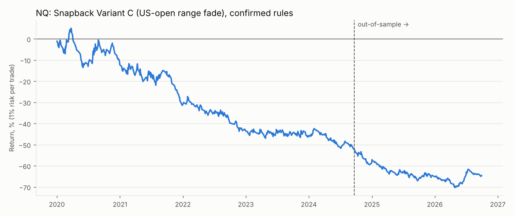
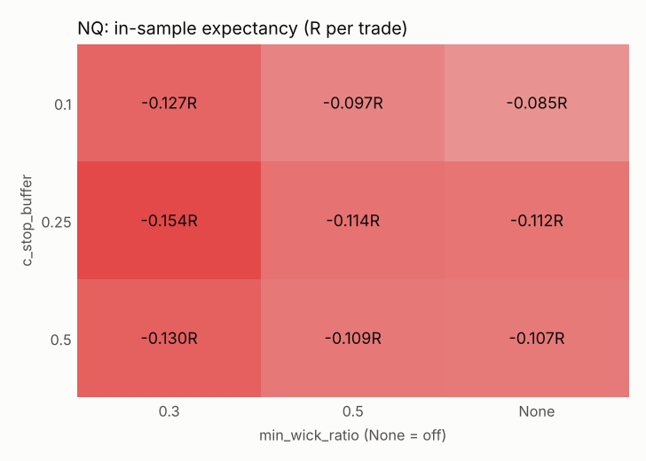
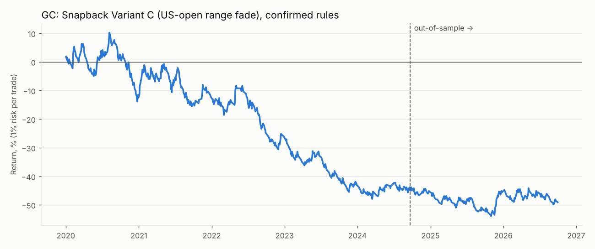
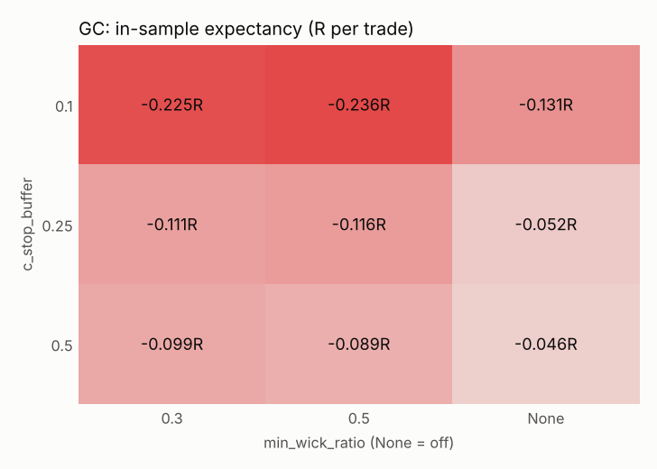

# Snapback Variant C (US-open range fade): backtest report
All R figures are after commission and slippage. Win rate is compared with the break-even win rate implied by the average win and loss.

_Note: the no_setup_pct column reads 0.00 in this run because of a since-fixed reporting bug; the actual share of days with no setup is about 62% (NQ) and 61% (GC)._

## Verdict
- **NQ: does not pass** the pre-paper-trading criteria. Failed: Positive OOS expectancy after costs; OOS profit factor >= 1.3; No collapse when one parameter moves one step (OOS exp > 0 for each); Beats random direction (p < 0.05); Not driven by a few huge days (exp. without top 5 > 0).
- **GC: does not pass** the pre-paper-trading criteria. Failed: Positive OOS expectancy after costs; OOS profit factor >= 1.3; No collapse when one parameter moves one step (OOS exp > 0 for each); Beats random direction (p < 0.05); Not driven by a few huge days (exp. without top 5 > 0).

## NQ
Sessions: 1745 (2020-01-02 → 2026-09-30); in-sample before 2024-09-20, out-of-sample after. Days skipped for contract roll: 0. Trades whose first target was already at or behind the entry price (long snapback candle): 0.
### Confirmed rules
| | trades | win_rate | breakeven_win_rate | avg_win_R | avg_loss_R | expectancy_R | profit_factor | max_dd_pct | longest_losing_streak | sharpe | no_setup_pct |
|---|---|---|---|---|---|---|---|---|---|---|---|
| In-sample | 450 | 29.56 | 34.89 | 1.87 | -1.00 | -0.15 | 0.78 | -54.35 | 19 | -1.06 | 0.00 |
| Out-of-sample | 215 | 30.70 | 35.39 | 1.81 | -0.99 | -0.13 | 0.81 | -37.95 | 12 | -0.96 | 0.00 |
| long (OOS) | 101 | 33.66 | 41.01 | 1.41 | -0.98 | -0.18 | 0.73 | -22.98 | 7 | nan |  |
| short (OOS) | 114 | 28.07 | 30.92 | 2.24 | -1.00 | -0.09 | 0.87 | -20.25 | 11 | nan |  |

**Win rate vs break-even:** OOS win rate 30.7% against the 35.4% needed to break even at these average win/loss sizes.

### Baselines (out-of-sample)
| | trades | win_rate | expectancy_R | profit_factor | sharpe |
|---|---|---|---|---|---|
| Strategy (confirmed rules) | 215 | 30.70 | -0.13 | 0.81 | -0.96 |
| Enter on first touch, no wick filter | 259 | 31.66 | -0.06 | 0.91 | -0.45 |
| Random direction (mean of seeds) | 215 |  | -0.09 |  |  |

Random-direction: 68% of 50 coin-flip runs did as well or better (p = 0.68).

Buy-and-hold 1x: in-sample 142.5% (Sharpe 0.78), out-of-sample 36.1% (Sharpe 0.71, max DD -29.0%).

### In-sample grid pick, checked out-of-sample
Best of 54 parameter combinations in-sample: `min_wick_ratio=None, b_window_hours=4, c_stop_buffer=0.5, c_target=mid`

| | trades | win_rate | breakeven_win_rate | avg_win_R | avg_loss_R | expectancy_R | profit_factor | max_dd_pct | longest_losing_streak | sharpe | no_setup_pct |
|---|---|---|---|---|---|---|---|---|---|---|---|
| In-sample (picked here) | 554 | 58.12 | 62.05 | 0.57 | -0.94 | -0.06 | 0.85 | -32.06 | 8 | -0.81 | 0.00 |
| Out-of-sample | 265 | 60.00 | 58.93 | 0.57 | -0.82 | 0.01 | 1.05 | -12.17 | 6 | 0.23 | 0.00 |

### Walk-forward
| | trades | win_rate | expectancy_R | profit_factor | max_dd_pct |
|---|---|---|---|---|---|
| Walk-forward (stitched test windows) | 414 | 40.82 | -0.12 | 0.80 | -52.31 |

| | test_start | test_end | train_exp_R | test_trades | test_exp_R | params |
|---|---|---|---|---|---|---|
| 0 | 2022-01-02 | 2022-07-02 | -0.03 | 23 | 0.40 | min_wick_ratio=0.5, b_window_hours=4, c_stop_buffer=0.1, c_target=opposite |
| 1 | 2022-07-02 | 2023-01-02 | 0.11 | 38 | -0.13 | min_wick_ratio=0.5, b_window_hours=2, c_stop_buffer=0.1, c_target=opposite |
| 2 | 2023-01-02 | 2023-07-02 | 0.08 | 35 | -0.12 | min_wick_ratio=0.5, b_window_hours=2, c_stop_buffer=0.1, c_target=opposite |
| 3 | 2023-07-02 | 2024-01-02 | 0.00 | 33 | -0.44 | min_wick_ratio=0.5, b_window_hours=2, c_stop_buffer=0.1, c_target=opposite |
| 4 | 2024-01-02 | 2024-07-02 | 0.02 | 60 | -0.11 | min_wick_ratio=None, b_window_hours=None, c_stop_buffer=0.5, c_target=mid |
| 5 | 2024-07-02 | 2025-01-02 | -0.00 | 56 | -0.26 | min_wick_ratio=None, b_window_hours=None, c_stop_buffer=0.5, c_target=mid |
| 6 | 2025-01-02 | 2025-07-02 | -0.03 | 35 | 0.02 | min_wick_ratio=0.5, b_window_hours=4, c_stop_buffer=0.5, c_target=mid |
| 7 | 2025-07-02 | 2026-01-02 | -0.03 | 46 | -0.09 | min_wick_ratio=0.5, b_window_hours=2, c_stop_buffer=0.5, c_target=mid |
| 8 | 2026-01-02 | 2026-07-02 | 0.03 | 64 | -0.10 | min_wick_ratio=None, b_window_hours=2, c_stop_buffer=0.1, c_target=mid |
| 9 | 2026-07-02 | 2027-01-02 | 0.01 | 24 | -0.12 | min_wick_ratio=0.3, b_window_hours=4, c_stop_buffer=0.1, c_target=mid |

### Sensitivity (one change at a time)
| | IS exp R | IS PF | IS trades | OOS exp R | OOS PF | OOS trades | OOS win % |
|---|---|---|---|---|---|---|---|
| confirmed rules | -0.15 | 0.78 | 450.00 | -0.13 | 0.81 | 215.00 | 30.70 |
| box_open_time=09:30 | -0.10 | 0.85 | 390.00 | -0.05 | 0.93 | 171.00 | 35.67 |
| min_wick_ratio=0.5 | -0.11 | 0.83 | 290.00 | -0.08 | 0.88 | 140.00 | 32.14 |
| min_wick_ratio=None | -0.11 | 0.84 | 542.00 | -0.06 | 0.91 | 259.00 | 31.66 |
| touch_depth=-0.1 | -0.11 | 0.83 | 643.00 | -0.11 | 0.83 | 280.00 | 33.21 |
| b_window_hours=4 | -0.14 | 0.80 | 464.00 | -0.12 | 0.82 | 219.00 | 31.05 |
| b_window_hours=None | -0.14 | 0.79 | 468.00 | -0.12 | 0.82 | 219.00 | 31.05 |
| c_stop_buffer=0.1 | -0.13 | 0.84 | 450.00 | -0.14 | 0.82 | 215.00 | 20.47 |
| c_stop_buffer=0.5 | -0.13 | 0.77 | 450.00 | -0.07 | 0.86 | 215.00 | 41.86 |
| c_target=mid | -0.13 | 0.76 | 450.00 | -0.03 | 0.95 | 215.00 | 49.77 |
| be_trigger=0.5 | -0.15 | 0.78 | 450.00 | -0.10 | 0.84 | 215.00 | 33.95 |
| skip_pct=10 | -0.20 | 0.72 | 340.00 | -0.12 | 0.83 | 168.00 | 30.95 |
| entry_mode=breakout | -0.11 | 0.84 | 542.00 | -0.06 | 0.91 | 259.00 | 31.66 |

### By year (confirmed rules, full period)
| | trades | win_rate | expectancy_R | total_R |
|---|---|---|---|---|
| 2020 | 96.00 | 28.12 | -0.12 | -11.92 |
| 2021 | 102.00 | 24.51 | -0.23 | -23.57 |
| 2022 | 88.00 | 28.41 | -0.21 | -18.42 |
| 2023 | 100.00 | 33.00 | -0.04 | -4.21 |
| 2024 | 95.00 | 30.53 | -0.27 | -25.62 |
| 2025 | 111.00 | 30.63 | -0.14 | -15.07 |
| 2026 | 73.00 | 35.62 | 0.02 | 1.50 |

### By weekday (confirmed rules, full period)
| | trades | win_rate | expectancy_R | total_R |
|---|---|---|---|---|
| Mon | 138.00 | 26.09 | -0.23 | -31.89 |
| Tue | 124.00 | 33.87 | -0.09 | -10.75 |
| Wed | 136.00 | 33.82 | -0.01 | -1.92 |
| Thu | 144.00 | 31.25 | -0.07 | -10.54 |
| Fri | 123.00 | 24.39 | -0.34 | -42.21 |

### Pass criteria
- FAIL: Positive OOS expectancy after costs
- FAIL: OOS profit factor >= 1.3
- PASS: At least ~100 OOS trades
- FAIL: No collapse when one parameter moves one step (OOS exp > 0 for each)
- FAIL: Beats random direction (p < 0.05)
- FAIL: Not driven by a few huge days (exp. without top 5 > 0)

## GC
Sessions: 1741 (2020-01-02 → 2026-09-30); in-sample before 2024-09-20, out-of-sample after. Days skipped for contract roll: 0. Trades whose first target was already at or behind the entry price (long snapback candle): 0.
### Confirmed rules
| | trades | win_rate | breakeven_win_rate | avg_win_R | avg_loss_R | expectancy_R | profit_factor | max_dd_pct | longest_losing_streak | sharpe | no_setup_pct |
|---|---|---|---|---|---|---|---|---|---|---|---|
| In-sample | 480 | 35.00 | 39.32 | 1.57 | -1.01 | -0.11 | 0.83 | -52.76 | 9 | -0.83 | 0.00 |
| Out-of-sample | 203 | 35.47 | 36.91 | 1.70 | -1.00 | -0.04 | 0.94 | -18.05 | 10 | -0.28 | 0.00 |
| long (OOS) | 112 | 40.18 | 38.03 | 1.65 | -1.01 | 0.06 | 1.09 | -16.70 | 6 | nan |  |
| short (OOS) | 91 | 29.67 | 35.32 | 1.79 | -0.98 | -0.16 | 0.77 | -25.09 | 10 | nan |  |

**Win rate vs break-even:** OOS win rate 35.5% against the 36.9% needed to break even at these average win/loss sizes.

### Baselines (out-of-sample)
| | trades | win_rate | expectancy_R | profit_factor | sharpe |
|---|---|---|---|---|---|
| Strategy (confirmed rules) | 203 | 35.47 | -0.04 | 0.94 | -0.28 |
| Enter on first touch, no wick filter | 243 | 34.57 | -0.05 | 0.92 | -0.39 |
| Random direction (mean of seeds) | 203 |  | -0.06 |  |  |

Random-direction: 38% of 50 coin-flip runs did as well or better (p = 0.38).

Buy-and-hold 1x: in-sample 41.1% (Sharpe 0.48), out-of-sample 44.0% (Sharpe 0.81, max DD -29.1%).

### In-sample grid pick, checked out-of-sample
Best of 54 parameter combinations in-sample: `min_wick_ratio=None, b_window_hours=2, c_stop_buffer=0.5, c_target=opposite`

| | trades | win_rate | breakeven_win_rate | avg_win_R | avg_loss_R | expectancy_R | profit_factor | max_dd_pct | longest_losing_streak | sharpe | no_setup_pct |
|---|---|---|---|---|---|---|---|---|---|---|---|
| In-sample (picked here) | 576 | 45.49 | 47.93 | 0.98 | -0.90 | -0.05 | 0.91 | -36.50 | 9 | -0.49 | 0.00 |
| Out-of-sample | 243 | 43.21 | 46.52 | 1.03 | -0.89 | -0.06 | 0.87 | -22.69 | 9 | -0.67 | 0.00 |

### Walk-forward
| | trades | win_rate | expectancy_R | profit_factor | max_dd_pct |
|---|---|---|---|---|---|
| Walk-forward (stitched test windows) | 500 | 47.80 | -0.09 | 0.82 | -41.12 |

| | test_start | test_end | train_exp_R | test_trades | test_exp_R | params |
|---|---|---|---|---|---|---|
| 0 | 2022-01-02 | 2022-07-02 | 0.00 | 28 | -0.02 | min_wick_ratio=0.5, b_window_hours=2, c_stop_buffer=0.5, c_target=mid |
| 1 | 2022-07-02 | 2023-01-02 | 0.02 | 35 | -0.39 | min_wick_ratio=0.5, b_window_hours=2, c_stop_buffer=0.5, c_target=mid |
| 2 | 2023-01-02 | 2023-07-02 | -0.01 | 56 | -0.17 | min_wick_ratio=None, b_window_hours=2, c_stop_buffer=0.25, c_target=opposite |
| 3 | 2023-07-02 | 2024-01-02 | -0.05 | 63 | -0.09 | min_wick_ratio=None, b_window_hours=2, c_stop_buffer=0.5, c_target=opposite |
| 4 | 2024-01-02 | 2024-07-02 | -0.05 | 59 | 0.07 | min_wick_ratio=None, b_window_hours=2, c_stop_buffer=0.5, c_target=opposite |
| 5 | 2024-07-02 | 2025-01-02 | -0.04 | 67 | -0.19 | min_wick_ratio=None, b_window_hours=2, c_stop_buffer=0.5, c_target=opposite |
| 6 | 2025-01-02 | 2025-07-02 | -0.04 | 60 | -0.05 | min_wick_ratio=None, b_window_hours=4, c_stop_buffer=0.5, c_target=opposite |
| 7 | 2025-07-02 | 2026-01-02 | -0.03 | 53 | -0.04 | min_wick_ratio=0.3, b_window_hours=4, c_stop_buffer=0.5, c_target=mid |
| 8 | 2026-01-02 | 2026-07-02 | 0.08 | 55 | 0.01 | min_wick_ratio=0.3, b_window_hours=4, c_stop_buffer=0.25, c_target=mid |
| 9 | 2026-07-02 | 2027-01-02 | 0.05 | 24 | -0.04 | min_wick_ratio=0.3, b_window_hours=2, c_stop_buffer=0.25, c_target=mid |

### Sensitivity (one change at a time)
| | IS exp R | IS PF | IS trades | OOS exp R | OOS PF | OOS trades | OOS win % |
|---|---|---|---|---|---|---|---|
| confirmed rules | -0.11 | 0.83 | 480.00 | -0.04 | 0.94 | 203.00 | 35.47 |
| box_open_time=09:30 | -0.10 | 0.84 | 427.00 | -0.23 | 0.67 | 186.00 | 29.57 |
| min_wick_ratio=0.5 | -0.12 | 0.82 | 330.00 | -0.19 | 0.72 | 131.00 | 31.30 |
| min_wick_ratio=None | -0.05 | 0.92 | 576.00 | -0.05 | 0.92 | 243.00 | 34.57 |
| touch_depth=-0.1 | -0.12 | 0.81 | 672.00 | -0.05 | 0.92 | 290.00 | 36.90 |
| b_window_hours=4 | -0.13 | 0.80 | 501.00 | -0.04 | 0.94 | 212.00 | 35.85 |
| b_window_hours=None | -0.14 | 0.79 | 509.00 | -0.04 | 0.93 | 217.00 | 35.94 |
| c_stop_buffer=0.1 | -0.23 | 0.73 | 480.00 | -0.15 | 0.81 | 203.00 | 24.14 |
| c_stop_buffer=0.5 | -0.10 | 0.80 | 480.00 | -0.07 | 0.87 | 203.00 | 43.84 |
| c_target=mid | -0.10 | 0.80 | 480.00 | 0.06 | 1.13 | 203.00 | 56.65 |
| be_trigger=0.5 | -0.10 | 0.84 | 480.00 | -0.04 | 0.94 | 203.00 | 37.44 |
| skip_pct=10 | -0.10 | 0.85 | 349.00 | -0.06 | 0.91 | 151.00 | 35.10 |
| entry_mode=breakout | -0.05 | 0.92 | 576.00 | -0.05 | 0.92 | 243.00 | 34.57 |

### By year (confirmed rules, full period)
| | trades | win_rate | expectancy_R | total_R |
|---|---|---|---|---|
| 2020 | 106.00 | 33.02 | -0.12 | -12.30 |
| 2021 | 105.00 | 40.95 | 0.01 | 1.20 |
| 2022 | 96.00 | 31.25 | -0.17 | -16.26 |
| 2023 | 103.00 | 29.13 | -0.25 | -25.39 |
| 2024 | 96.00 | 42.71 | -0.03 | -2.83 |
| 2025 | 102.00 | 35.29 | 0.00 | 0.09 |
| 2026 | 75.00 | 33.33 | -0.08 | -5.85 |

### By weekday (confirmed rules, full period)
| | trades | win_rate | expectancy_R | total_R |
|---|---|---|---|---|
| Mon | 149.00 | 35.57 | -0.06 | -9.24 |
| Tue | 131.00 | 41.22 | -0.01 | -1.01 |
| Wed | 132.00 | 29.55 | -0.20 | -26.03 |
| Thu | 128.00 | 33.59 | -0.14 | -18.48 |
| Fri | 143.00 | 35.66 | -0.05 | -6.57 |

### Pass criteria
- FAIL: Positive OOS expectancy after costs
- FAIL: OOS profit factor >= 1.3
- PASS: At least ~100 OOS trades
- FAIL: No collapse when one parameter moves one step (OOS exp > 0 for each)
- FAIL: Beats random direction (p < 0.05)
- FAIL: Not driven by a few huge days (exp. without top 5 > 0)

