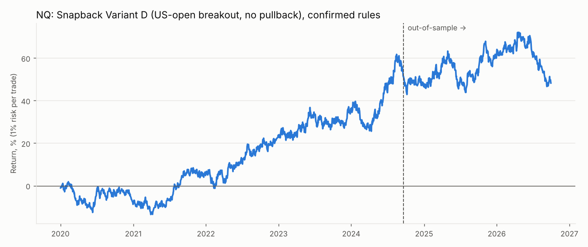
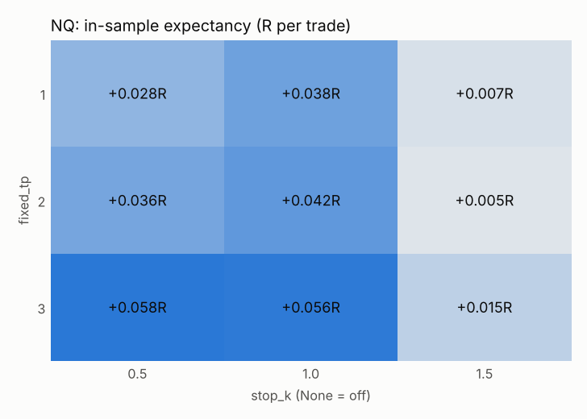
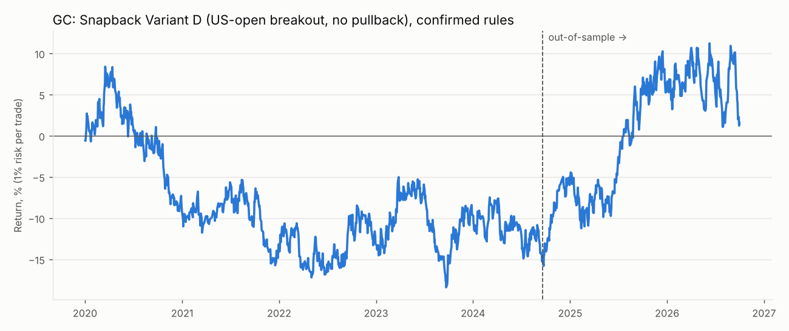
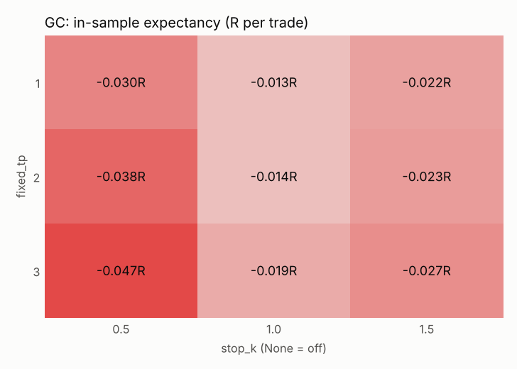

# Snapback Variant D (US-open breakout, no pullback): backtest report
All R figures are after commission and slippage. Win rate is compared with the break-even win rate implied by the average win and loss.

## Verdict
- **NQ: does not pass** the pre-paper-trading criteria. Failed: Positive OOS expectancy after costs; OOS profit factor >= 1.3; No collapse when one parameter moves one step (OOS exp > 0 for each); Beats random direction (p < 0.05); Not driven by a few huge days (exp. without top 5 > 0).
- **GC: does not pass** the pre-paper-trading criteria. Failed: OOS profit factor >= 1.3.

## NQ
Sessions: 1745 (2020-01-02 → 2026-09-30); in-sample before 2024-09-20, out-of-sample after. Days skipped for contract roll: 0. Trades whose first target was already at or behind the entry price (long snapback candle): 0.
### Confirmed rules
| | trades | win_rate | breakeven_win_rate | avg_win_R | avg_loss_R | expectancy_R | profit_factor | max_dd_pct | longest_losing_streak | sharpe | no_setup_pct |
|---|---|---|---|---|---|---|---|---|---|---|---|
| In-sample | 1095 | 50.23 | 47.61 | 0.85 | -0.77 | 0.04 | 1.11 | -15.09 | 8 | 0.68 | 10.32 |
| Out-of-sample | 459 | 50.11 | 50.19 | 0.70 | -0.71 | -0.00 | 1.00 | -14.80 | 6 | -0.02 | 12.40 |
| long (OOS) | 248 | 55.24 | 54.59 | 0.61 | -0.73 | 0.01 | 1.03 | -9.03 | 5 | nan |  |
| short (OOS) | 211 | 44.08 | 44.91 | 0.84 | -0.68 | -0.01 | 0.97 | -12.15 | 15 | nan |  |

**Win rate vs break-even:** OOS win rate 50.1% against the 50.2% needed to break even at these average win/loss sizes.

### Baselines (out-of-sample)
| | trades | win_rate | expectancy_R | profit_factor | sharpe |
|---|---|---|---|---|---|
| Strategy (confirmed rules) | 459 | 50.11 | -0.00 | 1.00 | -0.02 |
| Stop-order entry at the box edge | 495 | 49.09 | 0.02 | 1.04 | 0.25 |
| Random direction (mean of seeds) | 459 |  | 0.00 |  |  |

Random-direction: 54% of 50 coin-flip runs did as well or better (p = 0.54).

Buy-and-hold 1x: in-sample 142.5% (Sharpe 0.78), out-of-sample 36.1% (Sharpe 0.71, max DD -29.0%).

### In-sample grid pick, checked out-of-sample
Best of 72 parameter combinations in-sample: `entry_mode=stop, b_window_hours=2, fixed_tp=3, stop_k=0.5, be_trigger=1.0`

| | trades | win_rate | breakeven_win_rate | avg_win_R | avg_loss_R | expectancy_R | profit_factor | max_dd_pct | longest_losing_streak | sharpe | no_setup_pct |
|---|---|---|---|---|---|---|---|---|---|---|---|
| In-sample (picked here) | 1153 | 35.82 | 31.76 | 2.12 | -0.98 | 0.13 | 1.20 | -21.57 | 16 | 1.08 | 5.41 |
| Out-of-sample | 495 | 34.55 | 36.80 | 1.66 | -0.97 | -0.06 | 0.91 | -39.04 | 10 | -0.59 | 5.15 |

### Walk-forward
| | trades | win_rate | expectancy_R | profit_factor | max_dd_pct |
|---|---|---|---|---|---|
| Walk-forward (stitched test windows) | 1173 | 38.96 | 0.05 | 1.09 | -26.51 |

| | test_start | test_end | train_exp_R | test_trades | test_exp_R | params |
|---|---|---|---|---|---|---|
| 0 | 2022-01-02 | 2022-07-02 | 0.06 | 126 | 0.09 | entry_mode=stop, b_window_hours=None, fixed_tp=1, stop_k=0.5, be_trigger=None |
| 1 | 2022-07-02 | 2023-01-02 | 0.12 | 123 | 0.05 | entry_mode=stop, b_window_hours=2, fixed_tp=3, stop_k=0.5, be_trigger=None |
| 2 | 2023-01-02 | 2023-07-02 | 0.16 | 124 | 0.15 | entry_mode=stop, b_window_hours=None, fixed_tp=3, stop_k=0.5, be_trigger=1.0 |
| 3 | 2023-07-02 | 2024-01-02 | 0.19 | 125 | 0.15 | entry_mode=stop, b_window_hours=4, fixed_tp=3, stop_k=0.5, be_trigger=1.0 |
| 4 | 2024-01-02 | 2024-07-02 | 0.18 | 122 | 0.01 | entry_mode=stop, b_window_hours=4, fixed_tp=3, stop_k=0.5, be_trigger=1.0 |
| 5 | 2024-07-02 | 2025-01-02 | 0.13 | 128 | 0.15 | entry_mode=stop, b_window_hours=2, fixed_tp=3, stop_k=1.0, be_trigger=1.0 |
| 6 | 2025-01-02 | 2025-07-02 | 0.17 | 118 | -0.11 | entry_mode=stop, b_window_hours=2, fixed_tp=3, stop_k=0.5, be_trigger=1.0 |
| 7 | 2025-07-02 | 2026-01-02 | 0.11 | 125 | 0.00 | entry_mode=stop, b_window_hours=2, fixed_tp=3, stop_k=0.5, be_trigger=None |
| 8 | 2026-01-02 | 2026-07-02 | 0.10 | 122 | 0.05 | entry_mode=stop, b_window_hours=2, fixed_tp=3, stop_k=1.0, be_trigger=None |
| 9 | 2026-07-02 | 2027-01-02 | 0.08 | 60 | -0.17 | entry_mode=stop, b_window_hours=2, fixed_tp=3, stop_k=1.0, be_trigger=1.0 |

### Sensitivity (one change at a time)
| | IS exp R | IS PF | IS trades | OOS exp R | OOS PF | OOS trades | OOS win % |
|---|---|---|---|---|---|---|---|
| confirmed rules | 0.04 | 1.11 | 1095.00 | -0.00 | 1.00 | 459.00 | 50.11 |
| box_open_time=09:30 | 0.04 | 1.13 | 972.00 | -0.00 | 0.99 | 389.00 | 49.87 |
| entry_mode=stop | 0.08 | 1.18 | 1153.00 | 0.02 | 1.04 | 495.00 | 49.09 |
| b_window_hours=4 | 0.04 | 1.10 | 1150.00 | 0.00 | 1.01 | 487.00 | 50.92 |
| b_window_hours=None | 0.04 | 1.10 | 1175.00 | 0.00 | 1.01 | 495.00 | 50.71 |
| fixed_tp=1 | 0.04 | 1.11 | 1095.00 | 0.01 | 1.04 | 459.00 | 53.16 |
| fixed_tp=3 | 0.06 | 1.15 | 1095.00 | 0.00 | 1.00 | 459.00 | 49.89 |
| stop_k=0.5 | 0.04 | 1.06 | 1095.00 | -0.08 | 0.86 | 459.00 | 38.34 |
| stop_k=1.5 | 0.01 | 1.02 | 1095.00 | -0.01 | 0.97 | 459.00 | 51.63 |
| eod_exit=False | 0.08 | 1.13 | 733.00 | 0.10 | 1.17 | 298.00 | 39.60 |
| be_trigger=1.0 | 0.04 | 1.11 | 1095.00 | -0.00 | 1.00 | 459.00 | 50.98 |
| be_trigger=0.5 | 0.05 | 1.16 | 1095.00 | -0.02 | 0.95 | 459.00 | 55.99 |
| skip_pct=10 | 0.06 | 1.16 | 794.00 | -0.02 | 0.95 | 340.00 | 48.82 |

### By year (confirmed rules, full period)
| | trades | win_rate | expectancy_R | total_R |
|---|---|---|---|---|
| 2020 | 233.00 | 47.21 | -0.04 | -8.16 |
| 2021 | 222.00 | 52.25 | 0.07 | 15.09 |
| 2022 | 232.00 | 52.16 | 0.07 | 17.21 |
| 2023 | 236.00 | 51.27 | 0.05 | 10.70 |
| 2024 | 235.00 | 48.09 | 0.04 | 9.31 |
| 2025 | 225.00 | 53.78 | 0.04 | 9.54 |
| 2026 | 171.00 | 45.61 | -0.05 | -7.93 |

### By weekday (confirmed rules, full period)
| | trades | win_rate | expectancy_R | total_R |
|---|---|---|---|---|
| Mon | 308.00 | 47.73 | -0.05 | -14.98 |
| Tue | 323.00 | 50.77 | 0.06 | 18.93 |
| Wed | 315.00 | 47.94 | -0.01 | -3.47 |
| Thu | 320.00 | 48.75 | 0.02 | 6.72 |
| Fri | 288.00 | 56.25 | 0.13 | 38.57 |

### Pass criteria
- FAIL: Positive OOS expectancy after costs
- FAIL: OOS profit factor >= 1.3
- PASS: At least ~100 OOS trades
- FAIL: No collapse when one parameter moves one step (OOS exp > 0 for each)
- FAIL: Beats random direction (p < 0.05)
- FAIL: Not driven by a few huge days (exp. without top 5 > 0)

## GC
Sessions: 1741 (2020-01-02 → 2026-09-30); in-sample before 2024-09-20, out-of-sample after. Days skipped for contract roll: 0. Trades whose first target was already at or behind the entry price (long snapback candle): 0.
### Confirmed rules
| | trades | win_rate | breakeven_win_rate | avg_win_R | avg_loss_R | expectancy_R | profit_factor | max_dd_pct | longest_losing_streak | sharpe | no_setup_pct |
|---|---|---|---|---|---|---|---|---|---|---|---|
| In-sample | 983 | 46.39 | 47.47 | 0.66 | -0.60 | -0.01 | 0.96 | -24.73 | 9 | -0.25 | 19.29 |
| Out-of-sample | 435 | 47.13 | 43.88 | 0.77 | -0.61 | 0.04 | 1.14 | -9.13 | 10 | 0.76 | 16.83 |
| long (OOS) | 235 | 47.23 | 44.13 | 0.75 | -0.59 | 0.04 | 1.13 | -12.41 | 12 | nan |  |
| short (OOS) | 200 | 47.00 | 43.61 | 0.81 | -0.62 | 0.05 | 1.15 | -8.66 | 8 | nan |  |

**Win rate vs break-even:** OOS win rate 47.1% against the 43.9% needed to break even at these average win/loss sizes.

### Baselines (out-of-sample)
| | trades | win_rate | expectancy_R | profit_factor | sharpe |
|---|---|---|---|---|---|
| Strategy (confirmed rules) | 435 | 47.13 | 0.04 | 1.14 | 0.76 |
| Stop-order entry at the box edge | 476 | 47.48 | 0.05 | 1.14 | 0.80 |
| Random direction (mean of seeds) | 435 |  | -0.01 |  |  |

Random-direction: 4% of 50 coin-flip runs did as well or better (p = 0.04).

Buy-and-hold 1x: in-sample 41.1% (Sharpe 0.48), out-of-sample 44.0% (Sharpe 0.81, max DD -29.1%).

### In-sample grid pick, checked out-of-sample
Best of 72 parameter combinations in-sample: `entry_mode=stop, b_window_hours=None, fixed_tp=1, stop_k=0.5, be_trigger=None`

| | trades | win_rate | breakeven_win_rate | avg_win_R | avg_loss_R | expectancy_R | profit_factor | max_dd_pct | longest_losing_streak | sharpe | no_setup_pct |
|---|---|---|---|---|---|---|---|---|---|---|---|
| In-sample (picked here) | 1160 | 41.38 | 40.90 | 1.34 | -0.92 | 0.01 | 1.02 | -25.14 | 10 | 0.14 | 4.60 |
| Out-of-sample | 505 | 39.41 | 38.99 | 1.48 | -0.94 | 0.01 | 1.02 | -29.23 | 15 | 0.12 | 3.06 |

### Walk-forward
| | trades | win_rate | expectancy_R | profit_factor | max_dd_pct |
|---|---|---|---|---|---|
| Walk-forward (stitched test windows) | 1123 | 41.41 | 0.01 | 1.03 | -26.14 |

| | test_start | test_end | train_exp_R | test_trades | test_exp_R | params |
|---|---|---|---|---|---|---|
| 0 | 2022-01-02 | 2022-07-02 | 0.01 | 125 | 0.06 | entry_mode=stop, b_window_hours=None, fixed_tp=1, stop_k=1.0, be_trigger=None |
| 1 | 2022-07-02 | 2023-01-02 | 0.02 | 124 | 0.02 | entry_mode=stop, b_window_hours=4, fixed_tp=1, stop_k=1.0, be_trigger=None |
| 2 | 2023-01-02 | 2023-07-02 | 0.03 | 119 | 0.15 | entry_mode=stop, b_window_hours=None, fixed_tp=1, stop_k=0.5, be_trigger=None |
| 3 | 2023-07-02 | 2024-01-02 | 0.11 | 110 | -0.00 | entry_mode=stop, b_window_hours=2, fixed_tp=3, stop_k=0.5, be_trigger=1.0 |
| 4 | 2024-01-02 | 2024-07-02 | 0.11 | 126 | -0.07 | entry_mode=stop, b_window_hours=None, fixed_tp=3, stop_k=0.5, be_trigger=1.0 |
| 5 | 2024-07-02 | 2025-01-02 | 0.09 | 123 | 0.12 | entry_mode=stop, b_window_hours=2, fixed_tp=3, stop_k=0.5, be_trigger=1.0 |
| 6 | 2025-01-02 | 2025-07-02 | 0.11 | 113 | -0.08 | entry_mode=stop, b_window_hours=2, fixed_tp=3, stop_k=0.5, be_trigger=1.0 |
| 7 | 2025-07-02 | 2026-01-02 | 0.01 | 107 | 0.08 | entry_mode=breakout, b_window_hours=2, fixed_tp=2, stop_k=1.0, be_trigger=None |
| 8 | 2026-01-02 | 2026-07-02 | 0.07 | 118 | -0.05 | entry_mode=stop, b_window_hours=2, fixed_tp=1, stop_k=0.5, be_trigger=None |
| 9 | 2026-07-02 | 2027-01-02 | 0.11 | 58 | -0.19 | entry_mode=stop, b_window_hours=2, fixed_tp=3, stop_k=0.5, be_trigger=None |

### Sensitivity (one change at a time)
| | IS exp R | IS PF | IS trades | OOS exp R | OOS PF | OOS trades | OOS win % |
|---|---|---|---|---|---|---|---|
| confirmed rules | -0.01 | 0.96 | 983.00 | 0.04 | 1.14 | 435.00 | 47.13 |
| box_open_time=09:30 | -0.01 | 0.95 | 865.00 | 0.01 | 1.05 | 392.00 | 48.21 |
| entry_mode=stop | -0.00 | 0.99 | 1086.00 | 0.05 | 1.14 | 476.00 | 47.48 |
| b_window_hours=4 | -0.02 | 0.95 | 1076.00 | 0.04 | 1.13 | 472.00 | 47.46 |
| b_window_hours=None | -0.01 | 0.95 | 1112.00 | 0.04 | 1.14 | 485.00 | 48.04 |
| fixed_tp=1 | -0.01 | 0.96 | 983.00 | 0.01 | 1.05 | 435.00 | 49.43 |
| fixed_tp=3 | -0.02 | 0.94 | 983.00 | 0.04 | 1.12 | 435.00 | 46.44 |
| stop_k=0.5 | -0.04 | 0.92 | 983.00 | 0.05 | 1.10 | 435.00 | 40.69 |
| stop_k=1.5 | -0.02 | 0.90 | 983.00 | 0.03 | 1.15 | 435.00 | 48.97 |
| eod_exit=False | 0.03 | 1.04 | 645.00 | 0.08 | 1.12 | 339.00 | 38.94 |
| be_trigger=1.0 | -0.02 | 0.95 | 983.00 | 0.05 | 1.14 | 435.00 | 47.59 |
| be_trigger=0.5 | -0.02 | 0.92 | 983.00 | 0.03 | 1.11 | 435.00 | 49.66 |
| skip_pct=10 | -0.02 | 0.92 | 714.00 | 0.06 | 1.18 | 339.00 | 46.90 |

### By year (confirmed rules, full period)
| | trades | win_rate | expectancy_R | total_R |
|---|---|---|---|---|
| 2020 | 218.00 | 47.25 | -0.04 | -8.94 |
| 2021 | 186.00 | 47.31 | -0.03 | -5.05 |
| 2022 | 213.00 | 47.42 | 0.01 | 1.78 |
| 2023 | 209.00 | 47.37 | 0.02 | 4.61 |
| 2024 | 219.00 | 46.58 | 0.02 | 5.34 |
| 2025 | 207.00 | 47.34 | 0.06 | 12.22 |
| 2026 | 166.00 | 42.17 | -0.02 | -3.80 |

### By weekday (confirmed rules, full period)
| | trades | win_rate | expectancy_R | total_R |
|---|---|---|---|---|
| Mon | 290.00 | 44.83 | -0.02 | -4.95 |
| Tue | 275.00 | 49.09 | 0.04 | 10.14 |
| Wed | 283.00 | 45.23 | -0.01 | -2.60 |
| Thu | 287.00 | 47.04 | -0.02 | -4.84 |
| Fri | 283.00 | 47.00 | 0.03 | 8.41 |

### Pass criteria
- PASS: Positive OOS expectancy after costs
- FAIL: OOS profit factor >= 1.3
- PASS: At least ~100 OOS trades
- PASS: No collapse when one parameter moves one step (OOS exp > 0 for each)
- PASS: Beats random direction (p < 0.05)
- PASS: Not driven by a few huge days (exp. without top 5 > 0)

